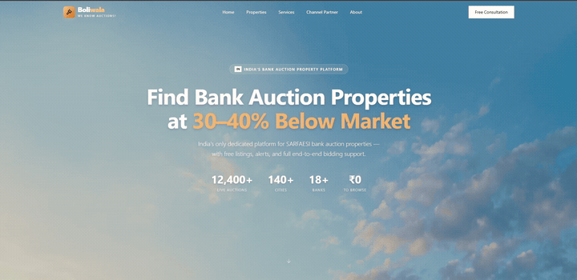

# 🏛️ Boliwala — Bank Auction Real-Estate Platform (Frontend Demo)

<div align="center">
  <p align="center">
    <b>A high-craft frontend showcase for a digital bank auction property platform.</b><br>
    Engineered with Next.js 16, React 19, Tailwind CSS v4, and Lenis smooth inertial scrolling.
  </p>

  <p align="center">
    <a href="https://boliwala.netlify.app/"></a>
    <a href="https://github.com/Akshayjg2204/boliwala"></a>
  </p>

  <p align="center">
    
    
    
    
    
    
  </p>
</div>

---

## 🎥 Hero Section & Interaction Preview

<div align="center">
  <a href="https://boliwala.netlify.app/">
    
  </a>
  <p align="center">
    <sub><b>✨ Autoplaying preview of the hero section interactions & smooth scroll dynamics.</b></sub><br>
    <b><a href="https://boliwala.netlify.app/">🚀 Launch Live Web App</a></b> &nbsp;•&nbsp; 
    <b><a href="./public/demo.mp4">📥 Download / Watch Full 60 FPS HD Video (MP4)</a></b>
  </p>
</div>

---

## ✨ Design & Engineering Highlights

- **⚡ Immersive Animated Hero Section:** Custom split-layout featuring dynamic headline entrance motion, quick-filter category pills, and intuitive property search affordances.
- **🌊 Ultra-Smooth Inertial Scrolling:** Integrated `@studio-freight/lenis` for buttery 60 FPS scroll velocity and frictionless viewport transitions.
- **🎨 Tailwind CSS v4 & Modern Micro-interactions:** Utilizes cutting-edge Tailwind v4 engine paired with `tw-animate-css` for hardware-accelerated animations and responsive layout scaling.
- **🧩 Accessible Component Architecture:** Built with headless [Radix UI](https://www.radix-ui.com/) primitives to guarantee full keyboard navigability and screen-reader accessibility.
- **📱 True Cross-Device Responsiveness:** Engineered from mobile-first viewports up to ultrawide desktop displays without layout degradation.

---

## 🛠️ Tech Stack

| Technology | Purpose |
| :--- | :--- |
| **Next.js 16 (App Router)** | Modern React framework for SSR and optimized client rendering |
| **React 19** | Latest concurrent React engine |
| **TypeScript** | Strict compile-time type safety across all components |
| **Tailwind CSS v4** | Next-generation utility-first styling engine |
| **Lenis** | Physics-based smooth inertial scrolling |
| **Radix UI** | Accessible, unstyled UI primitives (Dialogs, Dropdowns, Tabs) |
| **Lucide Icons** | Clean, consistent vector iconography |
| **Netlify** | Continuous deployment & edge network delivery |

---

## 🚀 Getting Started Locally

### Prerequisites
- Node.js 18+ or 20+
- pnpm (recommended) or npm

```bash
# 1. Clone the repository
git clone https://github.com/Akshayjg2204/boliwala.git
cd boliwala

# 2. Install dependencies
pnpm install
# or: npm install

# 3. Start development server
pnpm dev
# or: npm run dev
```

Open [http://localhost:3000](http://localhost:3000) in your browser to view the app.

---

## 👨‍💻 Author

**Akshay Gaikwad**  
Founder & Lead Engineer at [Streamline.dev](https://github.com/Streamline-dev0)  
- 🌐 Portfolio: [stream-line.dev](https://stream-line.dev/)  
- 💼 LinkedIn: [linkedin.com/in/akshayjgaikwad](https://www.linkedin.com/in/akshayjgaikwad/)  
- 🐙 GitHub: [@Akshayjg2204](https://github.com/Akshayjg2204)  
